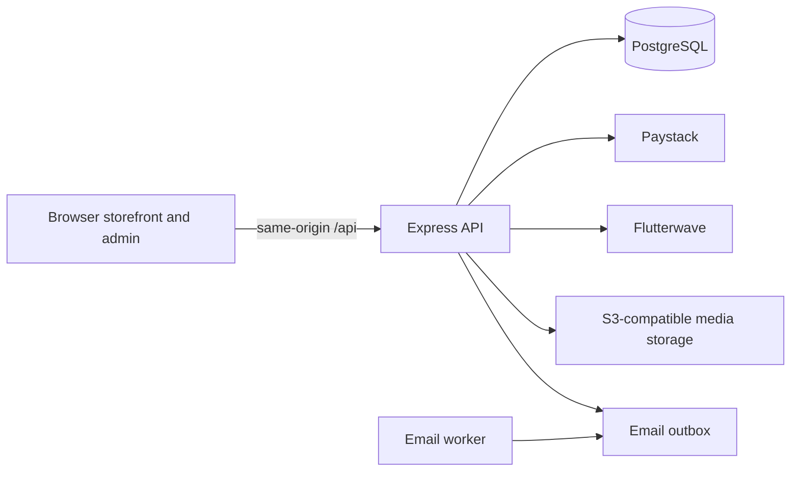

# SlaughterHouse

SlaughterHouse is a music production and beat marketplace with customer
accounts, bookings, Paystack and Flutterwave checkout, licensing, downloads,
merchandise, and an administrator dashboard.

## Architecture



The frontend is static HTML, CSS, and JavaScript. The backend is an Express
application exposed through Vercel serverless functions or run as a Node.js
service. PostgreSQL migrations are applied at startup under an advisory lock.
The email worker runs separately from serverless requests.

## Local development

Prerequisites: Node.js 22, npm, and PostgreSQL. From the repository root:

```powershell
npm ci --prefix backend
Copy-Item backend\.env.example backend\.env
```

Set `DATABASE_URL` in `backend\.env` to a local PostgreSQL database, then
change into `backend\` so dotenv loads that file. Initialize the schema and
start the API:

```powershell
Set-Location backend
node database.js
node server.js
```

For a complete local stack including the static frontend, PostgreSQL, and
persistent local media volumes, see [backend/README.md](./backend/README.md)
for Docker Compose instructions. The API also serves its health check at
`/api/health`.

After migrations are applied, a super-admin must set the USD-to-GHS exchange
rate in **Admin > Settings**. The rate must be updated every 24 hours; beat
checkout is disabled when it is missing or stale. Orders retain the rate and
rounded GHS amount used at checkout, so later rate changes do not alter
historical orders. GHS is paid through Paystack; USD, NGN, GBP, and EUR are
paid through Flutterwave with an admin-approved FX rate plus a 2% markup.

## Configuration reference

Use environment variables in the hosting provider's secret settings or in the
local `backend\.env`; never commit credentials.

| Variable | Purpose |
| --- | --- |
| `DATABASE_URL` | PostgreSQL connection string; use a pooled connection string for serverless deployments. |
| `DATABASE_URL_UNPOOLED` | Direct PostgreSQL URL used by backup and restore scripts when the runtime URL is pooled. |
| `DB_POOL_MAX` | PostgreSQL pool size per process; defaults to 3 on Vercel and 10 elsewhere. |
| `BACKUP_DATABASE_URL`, `BACKUP_DIR` | Optional direct backup connection and persistent backup output directory. |
| `NODE_ENV`, `PORT` | Runtime environment and local API port. |
| `FRONTEND_ORIGIN`, `FRONTEND_ORIGINS` | Trusted browser origins. |
| `API_PUBLIC_URL`, `PAYMENT_CALLBACK_URL`, `TRUST_PROXY` | Public API URL, payment return URL, and trusted proxy configuration. |
| `PAYSTACK_SECRET_KEY` | Paystack API and webhook verification secret (GHS checkout). |
| `FLUTTERWAVE_SECRET_KEY` | Flutterwave API secret key (USD, NGN, GBP, EUR checkout). |
| `FLUTTERWAVE_WEBHOOK_HASH` | Flutterwave webhook verification hash. |
| `DOWNLOAD_SIGNING_SECRET`, `CERTIFICATE_SIGNING_SECRET` | Distinct, stable signing secrets of at least 32 bytes in production. |
| `ADMIN_MFA_ENCRYPTION_KEY` | Independent, stable secret of at least 32 bytes used to encrypt administrator TOTP credentials. |
| `STORAGE_DRIVER` | Use `s3` for durable production storage. |
| `S3_BUCKET`, `S3_REGION`, `S3_ACCESS_KEY_ID`, `S3_SECRET_ACCESS_KEY` | S3-compatible media storage credentials. |
| `S3_ENDPOINT`, `S3_FORCE_PATH_STYLE`, `MEDIA_KEY_PREFIX`, `PUBLIC_MEDIA_BASE_URL` | Optional S3 endpoint and media URL configuration. |
| `EMAIL_API_KEY`, `EMAIL_FROM` | Email provider configuration. Run the separate email worker to process queued messages. |
| `ALLOW_EPHEMERAL_STORAGE` | Disposable-deployment override only; do not enable for production customer media. |
| `SQLITE_SOURCE_PATH` | Optional source database path for the legacy migration utility. |

See [backend/.env.example](./backend/.env.example) and the
[operations guide](./docs/operations.md) for all settings and production
procedures. Step-by-step staging and production instructions are in the
[deployment guide](./deployment.md).

## Testing

```powershell
npm test --prefix backend
npm run test:browser --prefix backend
```

The PostgreSQL route integration test runs only when `TEST_DATABASE_URL` points
to the dedicated local database named `slaughterhouse_route_test`. The
GitHub Actions workflow provisions an isolated PostgreSQL service and runs the
backend, migration, browser, deployment-configuration, and dependency-audit
checks on pull requests and pushes to `main`.

## Deployment

Vercel serves `frontend\` and routes `/api` to the serverless Express handlers.
Configure a pooled `DATABASE_URL`, stable signing secrets, Paystack and
Flutterwave credentials, email credentials, and S3-compatible storage in the
Vercel project. Run database
migrations as a deployment step before directing traffic to a release. Run
`npm run email:worker --prefix backend` in a persistent worker service. Review
backup and restore procedures in [docs/operations.md](./docs/operations.md)
before production use.
